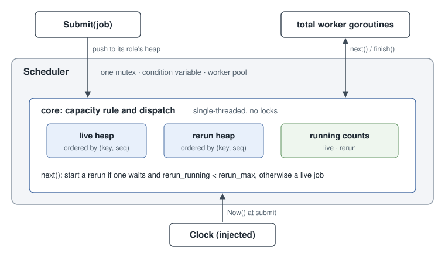

# Design

## Overview

One mutex guards all scheduler state, and a shared pool of `total` workers pulls jobs from two heaps, one per role. Each job's place in its heap comes from a sort key fixed at submission, so there are no timers.



The rules live in a single-threaded `core` with no locks or goroutines, wrapped by a thin `Scheduler` that adds the mutex, condition variable and workers. That makes the capacity logic testable directly, including with a seeded random test, and leaves the concurrency tests to prove just the wrapper.

## 1. Capacity rule and lifecycle accounting

Reruns get as many slots as they have work for, up to `rerun_max`, and live gets the rest:

```
rerun_need = min(rerun_max, reruns_running + reruns_waiting)
max_live   = total - rerun_need
```

The code doesn't actually compute `max_live`. When a slot frees up, it goes to a waiting rerun if there's room under `rerun_max`, and otherwise to live, which works out to the same thing. Since running jobs are never interrupted, live can stay above `max_live` for a while after reruns show up. So it's a target rather than a cap, and the tests check it only when a live job starts.

A job has three stages: **waiting**, **running** and **done**. Rerun work is waiting plus running, so a rerun counts from submission until it gives its slot back. There's no "claimed" stage in between, because picking a job and taking its slot happen in one locked step. If they were two steps, a rerun that had left the queue but not yet started would be invisible, and a live job could grab its slot.

Bad config is rejected up front. `rerun_max` has to be between 1 and `total`, because with 0 a rerun could never run and `Close` would hang.

## 2. Waiting jobs and workers across roles

There's **one shared pool of `total` workers**. A worker runs one job at a time, so an idle worker just means a free slot. Fewer workers would leave slots unused, and more would only sleep, since the dispatch rule enforces capacity, not the worker count. Separate pools per role would strand capacity.

Waiting jobs go into **two min-heaps, one per role**. Dispatch checks whether a rerun can start before looking at live. With one mixed heap, it would have to skip past reruns blocked by `rerun_max`, which could cost O(n).

## 3. Ordering, starvation of full jobs, and complexity

Each job gets a key when it's submitted, and the lowest key runs first. Ties go to whichever was submitted first.

| Job | Key |
|---|---|
| Quick | `submit_time` |
| Full | `submit_time + K` |

So quick jobs can pass a full job for up to K seconds after it arrives. Any quick job submitted after that gets a higher key and can't. Quick jobs that were already waiting keep their place, which is all the requirement asks for. Keys never change, so there are no timers, re-sorting or polling. Neither type can starve within a role, because every new key is at least the current time.

This only holds within a role. Across roles, reruns' claim on freed slots wins, so a new quick rerun can start ahead of a live full job that's waited past K, but only while fewer than `rerun_max` reruns are running.

Submit and pick are both **O(log n)**: a heap push or pop plus a few constant checks. `BenchmarkQueuePushPop` in `queue_test.go` measured a push and pop at about 200 to 290 ns with 50,000 jobs waiting, on an Apple M5 laptop.

The clock is an injected interface with just `Now()`, and the tests use a fake one. Go compares times using the monotonic reading, so wall-clock changes can't reorder jobs.

## 4. Concurrency hazards

| Hazard | Handling |
|---|---|
| A job leaves the queue before its slot is counted | Picking the job and taking the slot happen in one lock hold |
| A worker holds a slot with nothing to run | A slot is only ever taken together with a job |
| Lost wakeups | The queue push and `Signal` happen under the lock. A finished job frees one slot, so it can start at most one job, and the worker that finished takes it |
| A long job blocks the scheduler | `Run` executes outside the lock |
| A job panics | The panic is recovered and logged, so the slot is always released |
| Submit races Close | Both take the same lock, so a job is either rejected or guaranteed to run |
| Workers never exit on Close | Once closed, a worker with nothing to start exits. Anything still queued is a rerun at its limit, and the workers running reruns pick it up |

The tests use blocking jobs and channels instead of sleeps, and run under the race detector.

## 5. Urgent reruns

Urgency is an **ordering rule among reruns, not a capacity rule**. A rerun already beats live for every freed slot, so the only ways to start an urgent one sooner would break something:

- **Interrupting a live job:** running jobs are never interrupted.
- **Going over `rerun_max`:** it's a hard cap.
- **Keeping a slot free for urgent jobs:** slots shouldn't sit idle while something eligible waits.

Instead, normal reruns add U to their key:

| Rerun | Key |
|---|---|
| Urgent quick | `submit_time` |
| Normal quick | `submit_time + U` |
| Urgent full | `submit_time + K` |
| Normal full | `submit_time + K + U` |

An urgent rerun gets up to a U-second head start over a normal one of the same type, and a normal rerun can't starve: once it's waited U seconds, new urgent jobs line up behind it. "Urgent always first" was out, because a steady stream of urgent jobs would block normal reruns forever.

The cost is that new quick jobs can pass a **normal full rerun for K + U seconds** instead of K. That's a deliberate trade for one simple rule, with U meant to be small next to K. To keep K strict instead, normal full reruns would stay at `submit_time + K` and urgent full reruns would get `submit_time + K - U`, which needs U < K.

## 6. Multi-process or distributed deployment

- The mutex would become an atomic claim in a shared store, such as a transaction or compare-and-swap on the counters, so checking capacity and taking a slot stay one step.
- Workers can crash mid-job, so slots would need leases with heartbeats and timeouts to be reclaimed. A job could then run more than once, so jobs should be idempotent.
- Keys would need a single time source, since machine clocks differ.
- Queues and slot counts would need to survive restarts.

## 7. What I deliberately left out

- **`runtime.Goexit`:** a job that calls it crashes the process. Handling it would mean replacing dead workers.
- **Live starvation across roles:** if `rerun_max == total` and reruns keep coming, live never runs. The capacity rules allow this.
- **Hidden work:** a job is done when `Run` returns, so work it hands to its own goroutine isn't tracked.
- **Extras:** there's no cancelling queued jobs, no job results, no metrics, and a panic is only logged.
- **Out of scope by the spec:** retries, persistence and leases.
